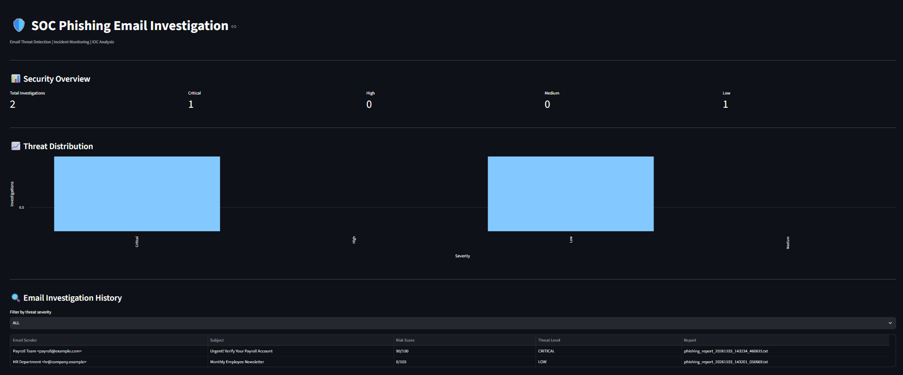
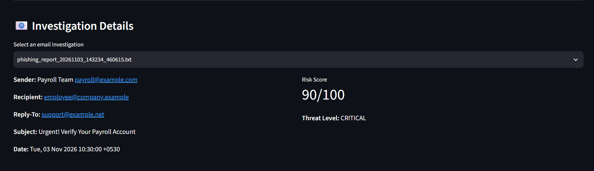
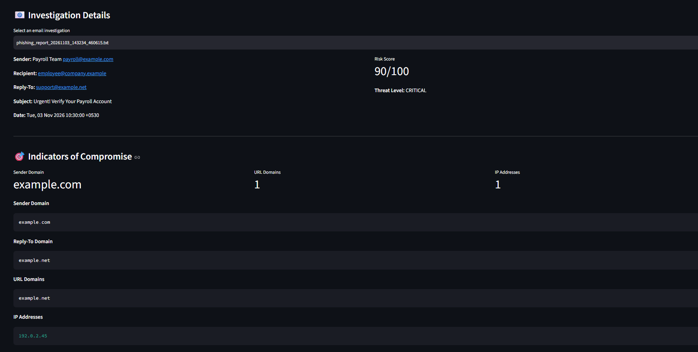
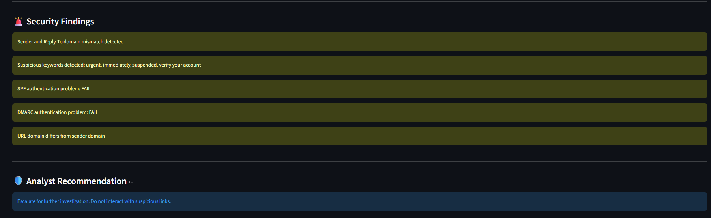
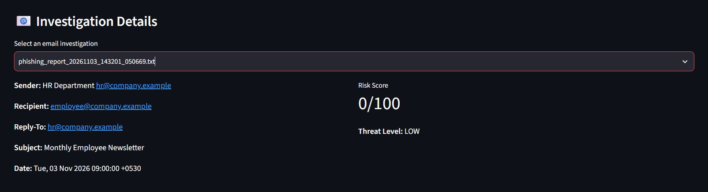
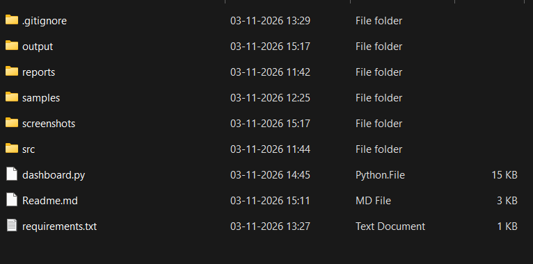

# SOC Phishing Email Investigation Tool

## Project Overview

The SOC Phishing Email Investigation Tool is a beginner-friendly cybersecurity project developed using Python and Streamlit.

It analyzes email files (`.eml`) to identify potentially suspicious indicators, calculate a phishing risk score, and generate investigation reports through an interactive SOC dashboard.

## Features

- Email header analysis (Sender, Recipient, Reply-To, Subject and Date).
- Email body extraction, including HTML content.
- URL and domain extraction.
- IP address extraction and validation.
- SPF, DKIM and DMARC authentication analysis.
- Rule-based phishing risk scoring.
- Threat classification (Low, Medium, High and Critical).
- Automated SOC investigation report generation.
- Interactive Streamlit dashboard.
- Investigation history and severity filtering.
- IOC visualization and report downloads.

## Technologies Used

- Python
- Streamlit
- Pandas
- Regular Expressions
- Python Email Parser
- IP Address Validation

## Project Structure

```text
PhishingEmailInvestigation/
│
├── samples/
│   ├── legitimate_email.eml
│   └── suspicious_email.eml
│
├── src/
│   └── analyzer.py
│
├── output/
│
├── dashboard.py
│
└── README.md
```

## Installation and Setup

### 1. Clone the repository

```bash
git clone YOUR_GITHUB_REPOSITORY_URL
cd PhishingEmailInvestigation
```

### 2. Install dependencies

```bash
pip install streamlit pandas
```

### 3. Run the email analyzer

Analyze the suspicious email:

```bash
python src/analyzer.py samples/suspicious_email.eml
```

Analyze the legitimate email:

```bash
python src/analyzer.py samples/legitimate_email.eml
```

### 4. Launch the SOC dashboard

```bash
streamlit run dashboard.py
```

## Sample Testing Results

| Test Email | Risk Score | Threat Level |
|---|---:|---|
| Suspicious Email | 90/100 | Critical |
| Legitimate Email | 0/100 | Low |

## Learning Outcomes

- Understanding phishing email investigation.
- Extracting and analyzing email headers.
- Identifying Indicators of Compromise (IOCs).
- Understanding SPF, DKIM and DMARC.
- Implementing basic rule-based threat detection.
- Generating SOC investigation reports.
- Building an interactive security monitoring dashboard.

## Disclaimer

This project is developed for educational purposes and controlled laboratory testing. Its rule-based scoring is a demonstration and should not be treated as a production-grade email security solution.

The sample emails use simulated data and reserved example domains and IP addresses.

## Project Screenshots

### 1. Dashboard Overview


### 2. Phishing Email Investigation


### 3. Indicators of Compromise (IOC) Analysis


### 4. Security Findings and Analyst Recommendation


### 5. Legitimate Email Investigation


### 6. Project Folder Structure

